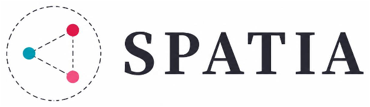
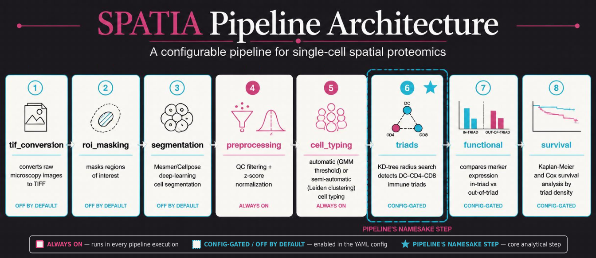
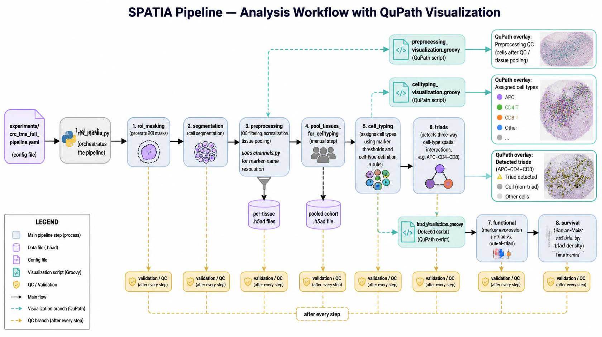

  

<b>Spatial Proteomics Automated cell-Typing and triadic Interaction Analysis</b>

SPATIA turns multiplexed spatial proteomics images (CyCIF, CODEX, and
similar platforms) into analysis-ready, single-cell results — automatically.
Starting from raw tissue images, it segments individual cells, assigns each
one a cell type, and detects **DC–CD4–CD8 "triads"**: three-cell spatial
groupings in the tumor microenvironment that are a core focus of this
research program. This repository is the reference implementation behind
the associated Nature Protocols manuscript.

## What SPATIA does for you

Given a tissue microarray (TMA) or whole-slide image, SPATIA automatically:

- Identifies and segments every individual cell in the tissue
- Assigns each cell a type (e.g. dendritic cell, CD4⁺ T cell, CD8⁺ T cell, tumor cell) based on its marker expression
- Detects three-cell **DC–CD4–CD8 triads** — spatial groupings linked to immune coordination in the tumor microenvironment — and quantifies their density across your samples
- Compares marker expression inside vs. outside triads
- Relates triad density to patient outcomes (overall and disease-free survival)
- Produces QC figures and visual overlays at every step, so results can be checked against the original tissue image rather than trusted blindly

You don't need to run any code yourself — SPATIA is deployed as a managed
pipeline on the **Cirro** platform (see below).

## Architecture & workflow

The full analysis workflow, including the visual QC overlays produced at
each stage (cell segmentation, assigned cell types, detected triads):

## Running SPATIA

SPATIA runs on **Cirro**, MD Anderson/BTC's managed analysis platform —
upload your dataset there, launch the `spatia-pipeline-for-cirro` process,
and Cirro handles the compute (AWS Batch) and result storage for you.

**Current status:** deployment on Cirro is working end-to-end for a sample
CRC (colorectal) TMA dataset. Scaling this up to the full combined dataset
is in progress.

## Learn more

- **Technical / developer details** (install, CLI usage, configuration, known limitations) — see [`docs/DEVELOPMENT.md`](docs/DEVELOPMENT.md)
- **Full documentation index** (every pipeline module, QuPath scripts, helper scripts) — see [`docs/README.md`](docs/README.md)
- **Project history and open decisions** — see `SPATIA_PIPELINE_LOG.md`
