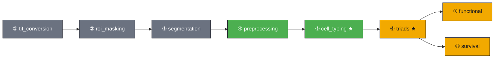

# SPATIA — Developer Guide


This is the technical companion to the [top-level README](../README.md),
which is written for *users* of the deployed pipeline. Everything here —
install steps, CLI usage, config internals, exit codes, known gaps — is for
people working on the `spatia/` codebase itself.

> [!WARNING]
> **Status:** actively being packaged for Cirro. The `spatia/` Python
> package has not yet been formally reviewed for correctness (tracked as Q8
> in `SPATIA_PIPELINE_LOG.md`). Treat this doc as accurate for *what the
> code does*, not yet as a guarantee that every step has been independently
> verified end-to-end on real data.

## Pipeline steps (technical)

`run_pipeline.py` chains eight steps, each independently toggleable via the
experiment config:

1. **tif_conversion** — raw scanner output (QPTIFF/OME-TIFF) → standard `.tif` + metadata
2. **roi_masking** — crop/mask ROIs or TMA cores using QuPath-exported masks
3. **segmentation** — Mesmer/Cellpose cell segmentation → per-cell CSV
4. **preprocessing** — filter, normalise, denoise, save as `.h5ad`
5. **cell_typing** ★ — GMM marker thresholds, cell-type assignment (automatic or semi-automatic)
6. **triads** ★ — detect DC–CD4–CD8 triads, compute density, plot
7. **functional** — in-triad vs. out-of-triad marker expression
8. **survival** — Kaplan–Meier OS/DFS stratified by triad density

★ = SPATIA's own novel contribution, not an established technique being wrapped.



<sub>🟩 always on · 🟨 config-gated · ⬜ off by default</sub>

Steps 1–3 are new upstream stages (added 2026-07-20) and default to
`enabled: false` so existing configs that already start from pre-segmented
data keep working unchanged. ROI selection itself (drawing/detecting TMA
cores) happens in QuPath, outside this script — see `qupath_scripts/`.

## Requirements

- **Python 3.9** — confirmed 2026-07-21 as the version used by BTC's
  JupyterHub, the only environment this has actually run `spacec`
  successfully in. `Dockerfile` and `pyproject.toml` are pinned to this.
  Package *versions* (exact `spacec`/`llvmlite`/`numba` pins) are still
  unconfirmed — only the Python version has a real source right now.

  > [!CAUTION]
  > `spacec`'s `llvmlite`/`numba` dependency chain is known to fail building
  > from source on some platforms unless installed from conda-forge first
  > (see `Dockerfile`'s ordering) — this ordering itself is still unverified
  > against a real build.

- Core dependencies (see `pyproject.toml`): `spacec`, `lifelines`, `kneed`,
  `seaborn`, `pyyaml`. `deepcell` is only needed if raw-image segmentation
  fails without it (see comment in `pyproject.toml`).

## Install

```bash
pip install -e .
```

This registers the `spatia` package via an editable install so
`spatia.analysis.*` imports correctly regardless of your working
directory or `PYTHONPATH` — this specifically fixes an import error
(`No module named 'spatia.analysis'`) seen in earlier manual runs.

> [!WARNING]
> **This has not been validated against a from-scratch environment build.**
> `pip install spacec` alone pulls in a large dependency chain (including
> `torch`); building/installing this needs a machine with a few GB of free
> disk and, per the note above, may need `llvmlite`/`numba` installed from
> conda-forge before `spacec` itself. See `Dockerfile` for the containerized
> version of this same install sequence — also not yet build-tested (see
> `SPATIA_PIPELINE_LOG.md`, Day 5).

## Usage (local CLI)

```bash
python run_pipeline.py --config experiments/crc_tma.yaml
```

```bash
# Run specific steps only
python run_pipeline.py --config experiments/crc_tma.yaml --steps preprocessing cell_typing

# Skip a step (e.g. preprocessing already done)
python run_pipeline.py --config experiments/crc_tma.yaml --skip preprocessing

# Preview what would run without executing anything
python run_pipeline.py --config experiments/crc_tma.yaml --dry-run
```

| Exit code | Meaning |
|:---:|---|
| `0` | all requested steps completed |
| `1` | one or more steps failed |
| `2` | config file not found or invalid |

## Configuration

One YAML file per experiment/run — see `spatia/config_example.yaml` for
the full annotated template and `experiments/` for real configs
(`crc_tma.yaml`, `crc_tma_full_pipeline.yaml`). Config sections:

- `experiment` — name, conditions, optional timepoints, condition→image-ID mapping
- `imaging` — microns-per-pixel, per-condition tissue area (for triad density)
- `paths` — segmentation/input/output directories, plus upstream-step paths if steps 1–3 are enabled
- `preprocessing`, `cell_typing`, `triads`, `functional`, `survival` — per-step parameters (thresholds, radii, marker lists)

> [!IMPORTANT]
> **Scope note:** this project's dataset scope is CRC TMA only. A separate
> config exists for the Matusiak (CODEX) dataset, but that dataset belongs to
> a different, separate project (the pan-cancer triads paper) — not this
> pipeline's scope. See `SPATIA_PIPELINE_LOG.md` for the full decision
> history behind this scoping.

## Cirro deployment (technical)


The sample CRC dataset runs successfully end-to-end on Cirro/AWS Batch.
The full combined-dataset run (all 4 TMA folders, 130 images) is in
progress — see `main.nf`, `nextflow.config`, and `.cirro/` (Cirro's
process-import config convention), and `SPATIA_PIPELINE_LOG.md` for the
packaging research and the full-dataset debugging history.

## QuPath integration

Cell segmentation and cell-type results can be exported to QuPath-readable
TSV files for manual visual verification and figure generation — see
`qupath_scripts/`. Two rendering fidelities exist on the QuPath side:
ellipse/centroid-only (`05-4-2_cell-typing_visualization.groovy`) and true
segmentation-polygon boundaries (`05-4-1_cell-typing_segmentation-boundries_visualization.groovy`).
Porting this visualization into the Python pipeline itself (rather than a
manual QuPath step) is in progress — see Q7 in `SPATIA_PIPELINE_LOG.md`.

## Project history and open decisions

`SPATIA_PIPELINE_LOG.md` in this folder is the append-only daily log of
decisions, findings, and open questions for this project. It is the
authoritative source for "why" behind choices in this codebase — check it
before assuming something here is finalized.

## Known limitations

> [!CAUTION]
> - `spatia/` package has not been formally reviewed for correctness (Q8, open).
> - Dockerfile and Nextflow wrapper are written but not build/run-tested.
> - Single-ROI workflow support (vs. multi-ROI/TMA) is not implemented.
